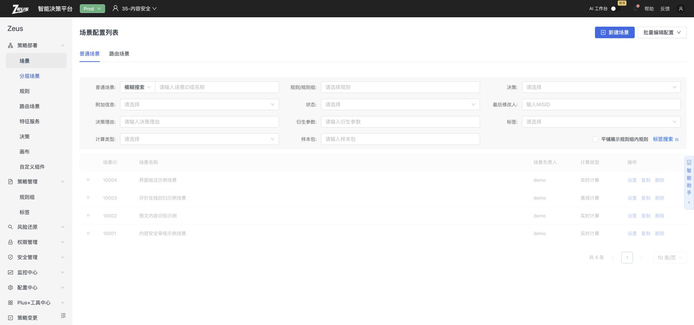
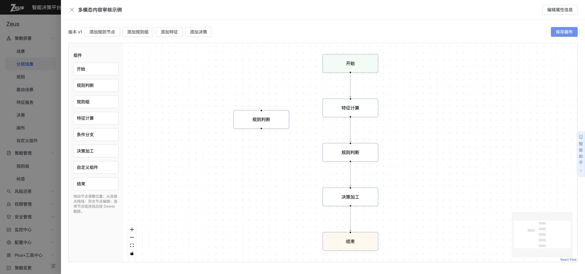

# Decision Intelligence Platform

基于 Zeus 实际页面观察实现的本地智能决策平台。前端包含 31 个模块入口，规则、特征和场景配置使用已授权的来源快照及本地示例，保存到 SQLite 数据库。

**当前是可运行的复刻基础版本，尚未达到所有页面、二级页面和按钮与原站完全一致。** 精确覆盖情况和未完成项见 [覆盖清单](docs/coverage.md)。

## 全量规则与关联特征

已收录内容安全空间 35 的 **28,583 条规则、19,732 个特征定义、1,157 份 RPC 依赖配置和 848 个接口入参定义**，启动时自动导入 SQLite。来源未提供定义的 141 个旧引用保留明确标记；未匹配的依赖名称也列在清单中，没有生成替代逻辑。范围、访问限速和重建方法见 [全量数据说明](docs/full-rule-catalog.md)。

```bash
npm run verify:catalog  # 逐条校验全量规则、特征与关联
```

## 指定的真实来源示例

已导入指定场景、规则组、分层画布、风险标签和变更任务。初始定向快照包含 **4,130 条规则、4,385 个特征及参数定义、1,052 个风险标签**，启动时自动恢复到 SQLite。数据范围、生效版本及来源缺失见 [导入清单](docs/imported-examples.md)。

## 运行

需要 Node.js 22 或更高版本。

```bash
npm ci
npm run dev
```

打开 http://127.0.0.1:5173/#/scene 。前端端口 5173，API 端口 3001。

```bash
npm test          # 使用临时数据库的接口集成测试
npm run build     # TypeScript 检查与前端生产构建
npm start         # 构建后，API 同时提供 dist 静态资源，端口 3001
```

可通过 `PORT` 修改后端端口；开发模式对应修改 `vite.config.ts` 代理地址。`DATABASE_PATH` 可指定 SQLite 文件位置，默认 `data/zeus.sqlite`。

## 现有操作

- 场景与规则组：展开规则配置，挂载规则，编辑决策、状态、优先级，批量修改配置。
- 规则：独立详情页、属性和表达式编辑、JSON 测试、测试记录、历史版本恢复、引用查询。
- 分层场景与画布：添加节点、拖动、连线、编辑节点属性、删除节点和连线、保存到数据库。
- 通用资源：筛选、分页、新建、编辑、复制、删除。标签、决策、特征、自定义组件及数据配置具有对应表单。
- 变更管理：本地示例的实验、审批、灰度推进、中止、回滚。
- 风险还原：本地示例日志查询、排查探针、累计查询、依赖关系检索。
- 日志配置、数据条目、查询收藏与表达式用例可保存到数据库。

所有读写均限本地服务，没有调用 Zeus 生产写接口。当前使用本地 `demo` 用户，未实现 SSO 或服务端权限控制。环境及空间菜单是界面演示，不会切换真实数据库或生产业务空间。

## 示例

| 对象            | 示例                                    |
| --------------- | --------------------------------------- |
| 场景            | 10001：内容安全审核示例场景             |
| 规则            | 20001：`riskScore > 0.9`                |
| 命中输入        | `{"riskScore":0.95}`                    |
| 不命中输入      | `{"riskScore":0.3}`                     |
| RequestId       | `demo-request-001` / `demo-request-002` |
| 累计因子 / 主体 | `requestCount` / `demo`                 |

示例执行引擎支持单变量比较、`&&`、`||`，不执行任意 JavaScript。它不等同于完整 Aviator / SQL / 近线 UDF 引擎。

## 结构

- `src/catalog.ts`：模块导航、筛选项、表格列和表单字段。
- `src/ModulePage.tsx`：资源列表、详情抽屉和变更任务。
- `src/RuleDetail.tsx`、`src/SceneRules.tsx`：规则详情和场景策略。
- `src/graph.tsx`：分层画布编辑。
- `src/ToolsPage.tsx`：风险查询与工具页面。
- `server/db.ts`：数据库建表及幂等示例数据初始化。
- `server/app.ts`：接口、表达式求值、版本、审计与变更流程。
- `tests/api.test.ts`：数据库与接口集成测试。

数据库包含 `entities`、`scene_rules`、`versions`、`audit`、`test_runs`、`settings`、`request_logs` 和 `cumulative_values`。数据库、WAL 文件及依赖不会提交到 Git。

## 界面预览




二、三级页面、版本管理、特征血缘和策略排查的补全范围见 [详情页说明](docs/detail-pages.md)。

已获授权的 6 个 CVID、31 条原始策略排查日志随仓库提供，启动后自动导入；时间窗和哈希见 `fixtures/zeus-logs-manifest.json`。
